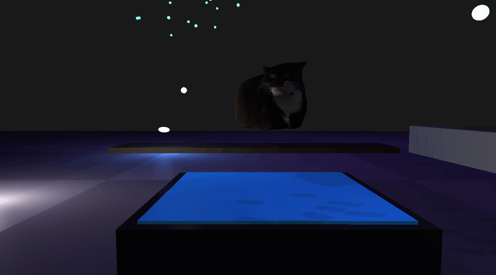
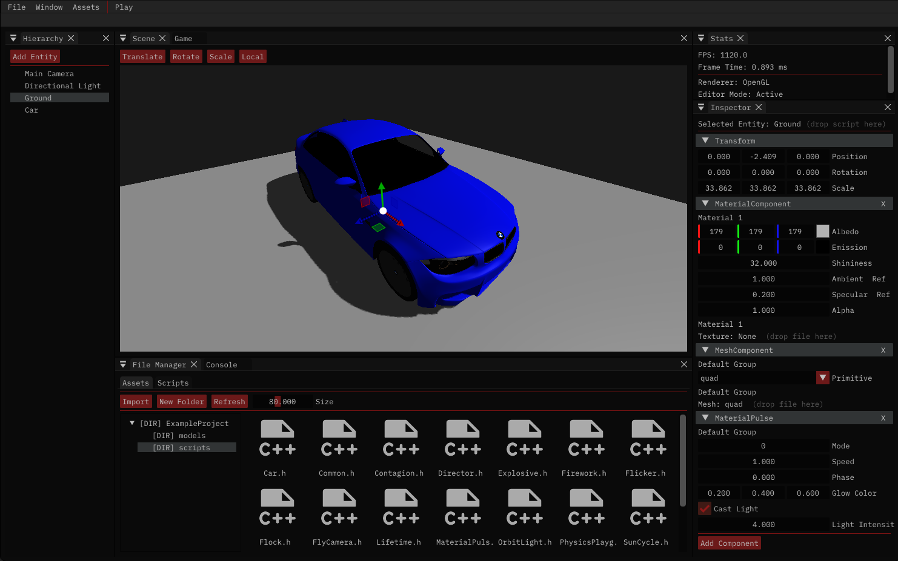
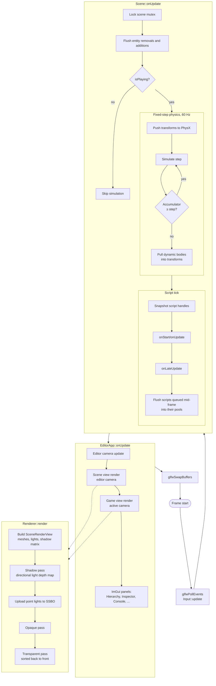
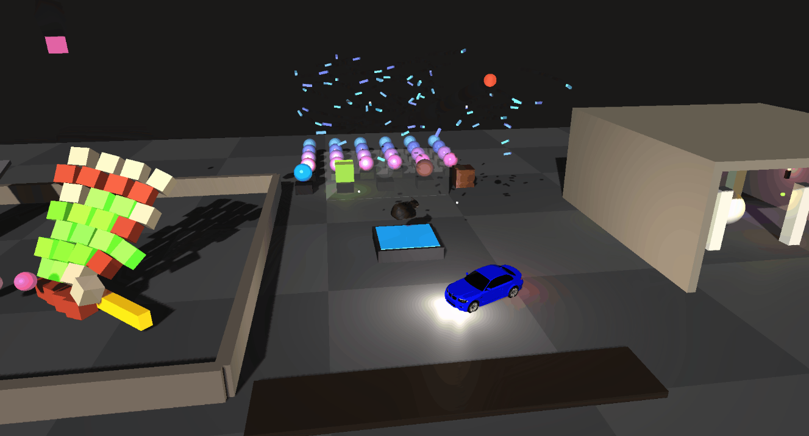

<h1 align="center">Vesta Engine</h1>

<p align="center">
  A C++17 game engine and editor with a custom ECS, reflection/property layer, hot-reloaded C++ scripting, PhysX physics and an OpenGL renderer.
</p>

<p align="center">
  
</p>

---

## Contents

- [Features](#features)
- [Scripting](#scripting)
- [Architecture](#architecture)
- [How To Build](#how-to-build)
- [Getting Started](#getting-started)
- [Example Vesta Project](#example-vesta-project)
- [Project Status](#project-status)
- [Third-party Libraries](#third-party-libraries)
- [License](#license)

---

## Features

### Editor
- Dockable ImGui editor with Hierarchy, Inspector, Scene view, Game view, Console, Stats and File Manager panels
- Translate / rotate / scale gizmos (ImGuizmo) and pixel-perfect mouse picking in the Scene view
- Inspector generated from reflected component and script properties
- Copy / paste of transforms, components and whole entities
- Play / Stop: the scene is snapshotted on Play and restored on Stop
- File Manager with file type icons and image thumbnails



### Entity Component System
- Sparse-set component pools with generational entity handles: stale handles are detected, never dereferenced
- Every entity owns a Transform; parent / child hierarchies keep world transforms on reparent
- Built-in components are lightweight handles over pooled data, so user code never holds pointers that a pool reallocation can invalidate
- Scripts live in type erased, per type pools; scripts added mid frame are queued and stay valid until the frame ends

### Renderer (OpenGL 4.3)
- Lit forward renderer with a directional light, shadow mapping and any number of point lights (SSBO)
- Sorted transparent pass
- OBJ + MTL loading with sub-meshes, per-sub-mesh materials and diffuse textures
- Built-in primitives (box, sphere, plane)

<!-- lighting video -->
https://github.com/user-attachments/assets/493d158f-249c-4294-96b2-53559785c025


### Physics (NVIDIA PhysX 5)
- Static, dynamic and kinematic rigid bodies
- Box, sphere, convex-hull and triangle-mesh colliders, cooked and cached per mesh
- Per-body friction and restitution
- Fixed 60 Hz simulation step

### Persistence
- Scenes are stored in Vesta's own compact, tagged binary format (`.vestascene`)
- Length prefixed records, so unknown data can be skipped when loading

---

## Scripting

Scripts are plain C++ headers inside the project folder. Fields declared with `SERIALIZE` show up in the Inspector and are saved with the scene.

```cpp
#pragma once
#include <scripting/Script.h>

BEGIN_SCRIPT(Turntable)
public:
    SERIALIZE(float, degreesPerSecond, 25.0f);
    SERIALIZE(float, floatHeight, 0.25f);

    void onStart() override {
        basePos = entity.getTransform().getPosition();
    }

    void onUpdate(float dt) override {
        time += dt;
        TransformComponent t = entity.getTransform();
        t.rotateAroundAxis(glm::vec3(0, 1, 0), degreesPerSecond * dt);
        t.setPosition(basePos + glm::vec3(0.0f, std::sin(time) * floatHeight, 0.0f));
    }

private:
    glm::vec3 basePos{ 0.0f };
    float time = 0.0f;
END_SCRIPT(Turntable)
```

**Hot reload:** The editor compiles every script into a single DLL with a bundled `clang-cl`,
then swaps it in while the editor (and possibly the scene) keeps running. Serialized script state
is saved before the swap and restored afterwards, so a running scene picks up code changes without losing its values.
Development is almost uninterrupted however, because compiling scripts doesn't restart the scene your `onStart` functions won't run,
that can cause problems depending on your scene structure and script logic.

<!-- script compiling video -->


https://github.com/user-attachments/assets/eff945e9-9f06-4108-85bf-0749eba2f860


Lifecycle hooks: `onAttach`, `onStart`, `onUpdate`, `onLateUpdate`, `onDetach`.

---

## Architecture

```
Vesta-Engine/
├── Vesta/            Engine (shared library)
│   ├── include/      Public API used by scripts (Entity, components, Script.h, properties)
│   └── src/
│       ├── ecs/          Entity manager, component pools, script pools
│       ├── scene/        Scene, Entity, component proxies and systems
│       ├── renderer/     OpenGL renderer, shaders, meshes, materials, OBJ loader
│       ├── physics/      PhysX world, bodies, collision shapes
│       ├── persistence/  Binary archive and scene serializer
│       ├── property/     Reflection used by the Inspector and serialization
│       ├── scripting/    Script compiler, DLL loader, hot-reload state cache
│       └── core/         Application loop, input, assets, projects
├── VestaEditor/      Editor (static library): ImGui panels and controllers
├── VestaRuntime/     Executable
├── ExampleProject/   Demo project with sample scripts and models
├── external/         Git submodules
└── dependencies/     Prebuilt PhysX and LLVM (Git LFS)
```

### How a Frame is Rendered



**Frame order:** fixed-step physics (push transforms → simulate → pull transforms) → `onUpdate` → `onLateUpdate` → render.

**Components.** Built-in data (`Transform`, `Camera`, lights, `MeshData`, `MaterialData`, `RigidBody`) lives in dense pools that systems iterate directly. Users work with proxy types (`TransformComponent`, `RigidBodyComponent`, …) that look up the data through the entity handle on every call.

---

## How To Build

**Requirements**
- Windows 10/11, x64
- Build Tools For Visual Studio (not the IDE itself)
- CMake 3.26+ and Ninja (both ship with Visual Studio)
- [Git LFS](https://git-lfs.com/): PhysX libraries and the bundled LLVM toolchain are stored in LFS

```bash
git clone --recursive https://github.com/BedirhanTheDude/Vesta-Engine.git
cd Vesta-Engine && git lfs pull
cmake --preset x64-release
cmake --build out/build/x64-release
```

Or open the folder in Visual Studio and pick the `x64 Debug` / `x64 Release` preset. You can also use any other IDE that has a CMake extension.

The build copies everything the editor needs next to `VestaRuntime.exe`: the script compiler, the engine headers and the import library.

---

## Getting Started

1. Run `VestaRuntime.exe`.
2. **File → Open Project** and select a project folder (try `ExampleProject/`), or **File → New Project**.
3. Open `Demo.vestascene` from the File Manager or create a script from **File → New Scene**.
4. Create a script from the File Manager, attach it to an entity in the Inspector.
5. You can write arbitrarily complex behaviour with scripts.
6. Press **Assets → Compile Scripts**
7. Press **Play**.

---

## Example Vesta Project

`ExampleProject/` contains a demo scene and a set of sample scripts:

| Script | What it shows |
|---|---|
| `FlyCamera` | Free-fly camera controls |
| `Turntable` | Loading an OBJ model at runtime, spinning it |
| `OrbitLight`, `Flicker`, `SunCycle` | Animated point and directional lights |
| `MaterialPulse` | Driving material parameters from code |
| `PhysicsPlayground`, `Explosive` | Rigid bodies, forces, impulses |
| `Car` | Kinematic physics actor, drives in a circle |
| `Firework`, `Lifetime` | Spawning and destroying entities at runtime |
| `Flock`, `Contagion` | Many interacting entities |
| `Director` | Orchestrating the other demos |

[](https://www.youtube.com/watch?v=m5kBnAPgg8o)
**[Video of Demo Scene Running](https://www.youtube.com/watch?v=m5kBnAPgg8o)**

---

## Project Status

Vesta is a personal project written by hand and is under active development, it has been and continues to be a great learning tool.
A physically based renderer is planned for the future as well as many little optimizations to the general engine architecture to make
it ready for an actual game. Unfortunately the engine currently only supports Windows but Linux support is planned too.

## Third-party Libraries

| Library | Use |
|---|---|
| [GLFW](https://github.com/glfw/glfw) | Window and input |
| [glad](https://github.com/Dav1dde/glad) | OpenGL loader |
| [GLM](https://github.com/g-truc/glm) | Math |
| [Dear ImGui](https://github.com/ocornut/imgui) | Editor UI |
| [ImGuizmo](https://github.com/CedricGuillemet/ImGuizmo) | Transform gizmos |
| [NVIDIA PhysX 5](https://github.com/NVIDIA-Omniverse/PhysX) | Physics |
| [tinyobjloader](https://github.com/tinyobjloader/tinyobjloader) | OBJ loading |
| [stb](https://github.com/nothings/stb) | Image loading |
| [lunasvg](https://github.com/sammycage/lunasvg) | SVG icons in the editor |
| [LLVM clang-cl / lld](https://llvm.org/) | Bundled script compiler |

## License

Vesta is completely open source and is licensed under an MIT license, see [LICENSE](LICENSE).
